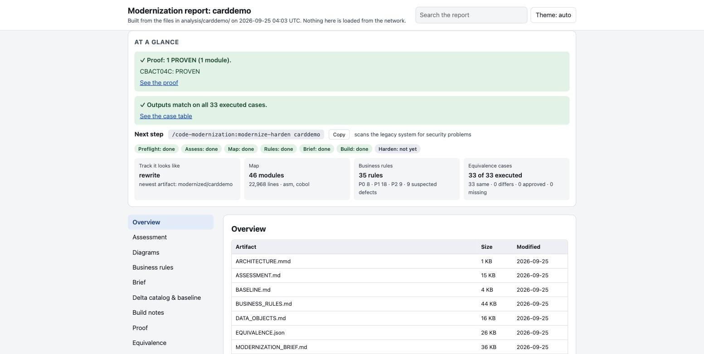
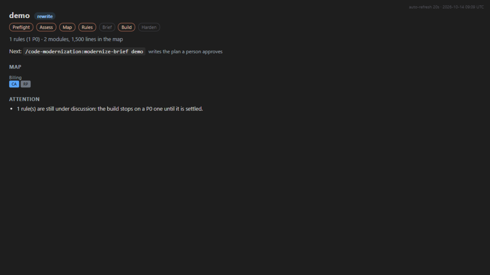

# Code Modernization for ZCode

[](LICENSE)
[](#install)
[](https://github.com/anthropics/claude-plugins-official/tree/main/plugins/code-modernization)
[](code-modernization/scripts/tests)

Point the agent at a legacy codebase and get four things: an understanding of what it is and what it
does, a plan you approve, the modernized code, and **proof that the new code behaves like the old**.
It works with any language and any kind of move: a newer version of the same technology, a rewrite in
another one, or a rebuild on a new architecture.

This is the **ZCode port** of Anthropic's `code-modernization` plugin (upstream 1.0.0, Apache-2.0).
Same commands, same agents, same proof machinery; every harness-specific part is rebuilt on ZCode's
documented APIs. [What the port changed](#what-the-zcode-port-changes) ·
[full changelog](code-modernization/CHANGELOG.md).





## The path

Each step stands alone, so you can stop and review after any of them.

| Step | Command | What you get |
| --- | --- | --- |
| 0 | `modernize` | Say what you want. Writes `INTENT.md`; every later command reads it. |
| 1 | `modernize-preflight` | Is the environment ready? Five questions only a person can answer, a build smoke test, missing-source check. |
| 2 | `modernize-assess` | Inventory, complexity, debt, security, and a recommended pattern. |
| 3 | `modernize-map` | Dependencies, data flow, entry points and business flows, as an interactive map. |
| 4 | `modernize-extract-rules` | The business rules as testable Given/When/Then cards with `file:line` citations, each re-checked by a referee agent, P0 rules confirmed by a two-judge panel. |
| 4b | `modernize-review` / `modernize-review-pane` | A person confirms or corrects the rules that look wrong. Your answers reach the plan and the build. |
| 5 | `modernize-brief` | The phased plan a steering committee approves. **Nothing is built until you approve it.** |
| 6 | `modernize-uplift` / `-transform` / `-reimagine` | The build: a same-stack version bump, a module-by-module rewrite, or a greenfield rebuild. |
| 7 | `modernize-verify` | **The proof.** An independent re-check with one verdict per module: PROVEN, PARTLY PROVEN or NOT PROVEN — computed by a script, never by the model. |
| 8 | `modernize-harden` | A security scan of the legacy system with a reviewed patch you apply yourself. |

`modernize-status <name>` says where you are and gives the exact command to paste.
`assess --portfolio <parent-dir>` surveys many systems and ranks them on one page.

**A person decides at six points**, and the plugin never decides them for you: the five preflight
answers, the rules that look wrong, approving the brief, accepting any difference the proof finds,
signing the proof, and applying the security patch.

## Install

From this repository as a marketplace:

1. Open **Plugin Marketplace → Add → Add Plugin Marketplace** and paste this repository's URL
   (or a local clone of it).
2. Open the market and **Install** *Code Modernization*.
3. Open a folder with the code you want to modernize and type `/code-modernization:modernize`.

Requirements: Python 3.8+ as `python3` (on Windows `python` or `py -3` works) for the map, shard
builder, proof scripts, report and dashboard; optionally [`scc`](https://github.com/boyter/scc) or
`cloc` for size metrics and a build toolchain for your stack, which enables the strongest proof —
running old and new side by side. Without a toolchain the plugin falls back to recorded-output tests
and says so.

Start with one module or one unit as a pilot, not the whole estate: the heaviest step started 50–200
agents on the systems it was tested on, and every fan-out says how many it will start before starting.

## How it proves the result

Modernization fails quietly: the new code passes the tests someone wrote, and differs on the inputs
nobody thought of. So the proof is built from evidence a script can check, not from the model's
opinion. `modernize-verify` re-runs the tests from clean, re-runs your own canary (a deliberate break
that must turn tests red), runs old and new on the same inputs byte-for-byte, invents at least ten
inputs nobody used, and requires every P0 business rule to be named by a test that executed and
passed. Each module gets one verdict — **PROVEN**, **PARTLY PROVEN** or **NOT PROVEN** — computed by
`scripts/proof_pack.py` from files it parses itself. Anything a person must decide is listed as
waiting for a person and is never ticked for you.

## What the ZCode port changes

| Upstream (Claude Code) | This port (ZCode) |
| --- | --- |
| Live transcript pane on early-access function hooks | `modernize-panel`: a self-contained dashboard (`PANE.html`, auto-refresh) built by `scripts/build_pane.py`; `modernize-review-pane` and `modernize-sign` as real commands. The upstream pane source is kept under `hooks/` for reference. |
| `Workflow`-tool scripts for multi-agent fan-outs | The same pipelines run through the `Agent` tool with per-item journals under `analysis/<system>/`, so any stopped run resumes where it left off. The upstream scripts stay in `workflows/` as the normative spec ([workflows/README.md](code-modernization/workflows/README.md)). |
| Deny rule hand-added to `.claude/settings.json` | A built-in **Source guard** hook denies writes under `legacy/` (symlink targets included). Option: `auto` / `on` / `off`. |
| (no equivalent) | **X-ray reads**: a `PostToolUse` hook attaches what the analysis knows about a legacy file — callers, data it touches, the rules citing it — as context only the model sees. |
| Five telemetry hooks incl. `StopFailure` | The same whole-numbers-only counts on ZCode's seven events; model-error counts are dormant (no `StopFailure` in ZCode). |
| Named command arguments (`arguments:`) | Arguments arrive as one `$ARGUMENTS` string; every command defines how to split it. |
| Agent tools `Glob`, `Grep` | ZCode tool set: search goes through Bash. |
| Reimagine handoff as `CLAUDE.md` | Written as `AGENTS.md`, what ZCode reads. |

## Safety

- **Analyzed code is untrusted input.** Agents treat file content as data, list instruction-shaped
  text they found and never follow it; verification agents re-derive every rule and finding from the
  cited code; `brief` is a human approval gate before anything is built.
- **The source is never edited.** By convention in every command, and in earnest by the Source guard
  hook. The operating system (a read-only mount, a sandbox) remains the only complete guarantee.
- **Secrets stay out of shared artifacts.** Discovered credentials are masked (`AKIA****`) and
  inventoried in a gitignored `SECRETS.local.md`; `harden` keeps credential-removal hunks in a
  separate gitignored patch.
- **The old system runs only where it is safe**: locally or against a test environment you named;
  production and real data are off limits unless your approved plan says otherwise.

## Telemetry

The plugin counts how it is used — **whole numbers only**: which command ran, how many rules were
found, what kind of machine and python it runs on, which kind of error occurred. Never code, names,
paths, prompts or error text; nothing is sent when harness telemetry is off. Turn it off with the
plugin's **Usage counts** option or `CODE_MODERNIZATION_TELEMETRY=0`. See exactly what would be sent:

```bash
python code-modernization/scripts/telemetry.py show /path/to/workspace
```

## Credits and license

Upstream plugin by [Anthropic](https://github.com/anthropics/claude-plugins-official)
(Apache-2.0); the upstream README documents the tested runs — AWS CardDemo rewritten from COBOL,
Eclipse Jetty uplifted Java 8 → 17, osCommerce PHP → Python, and more. ZCode port by
[re-obscura](https://github.com/re-obscura), also Apache-2.0 — see [LICENSE](LICENSE) and the
[port changelog](code-modernization/CHANGELOG.md).
